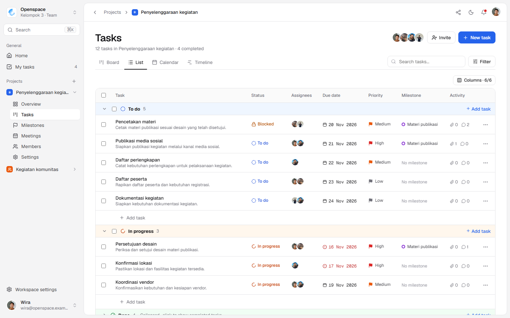
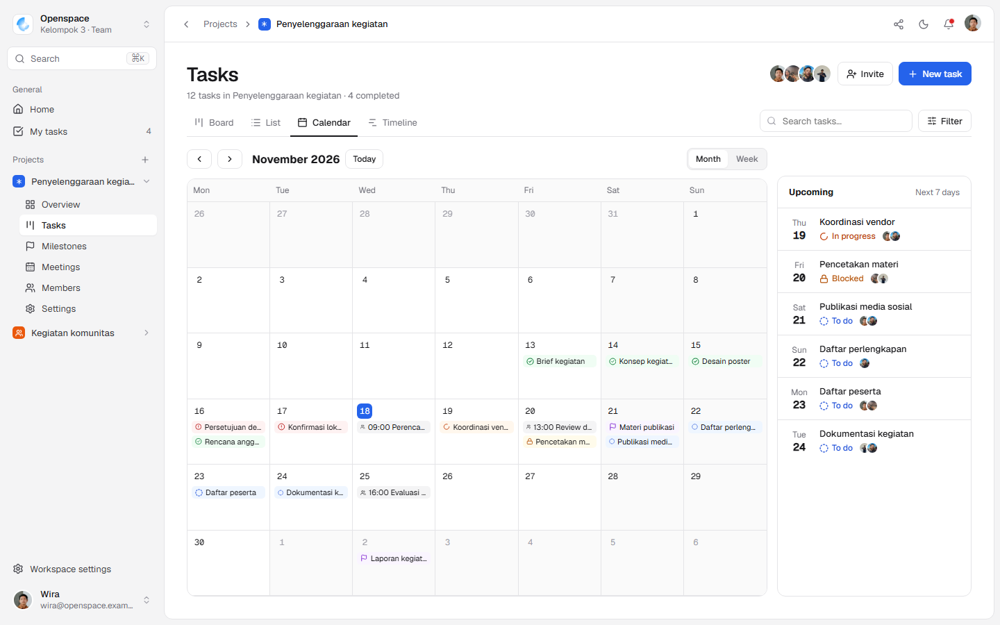
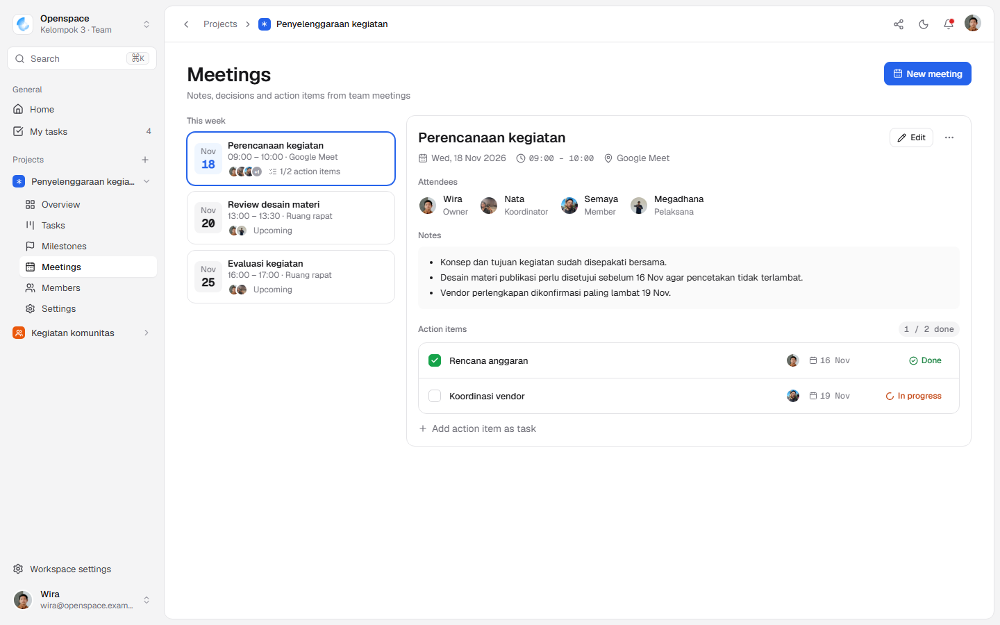
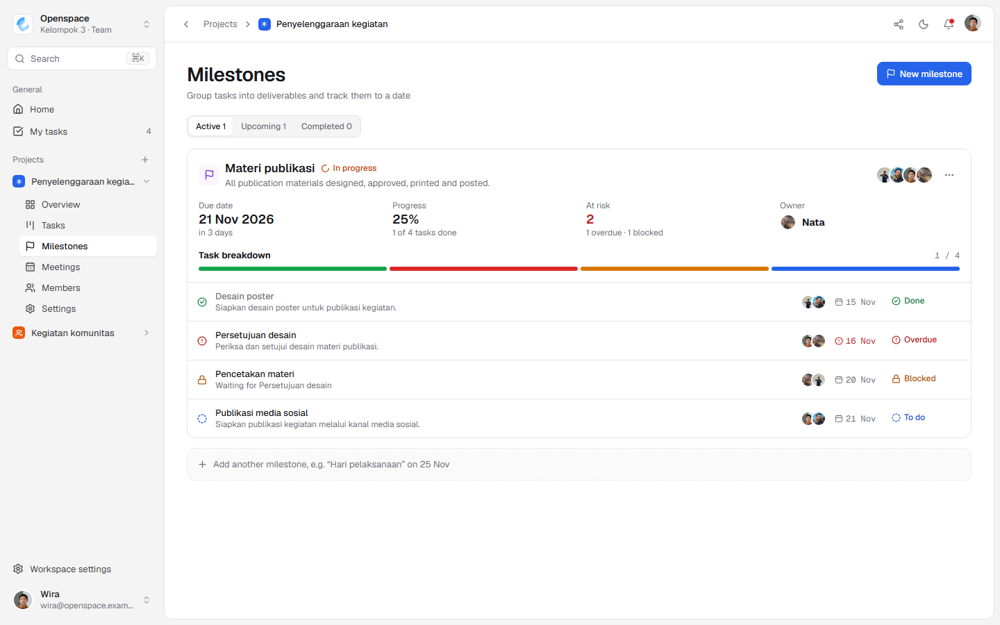
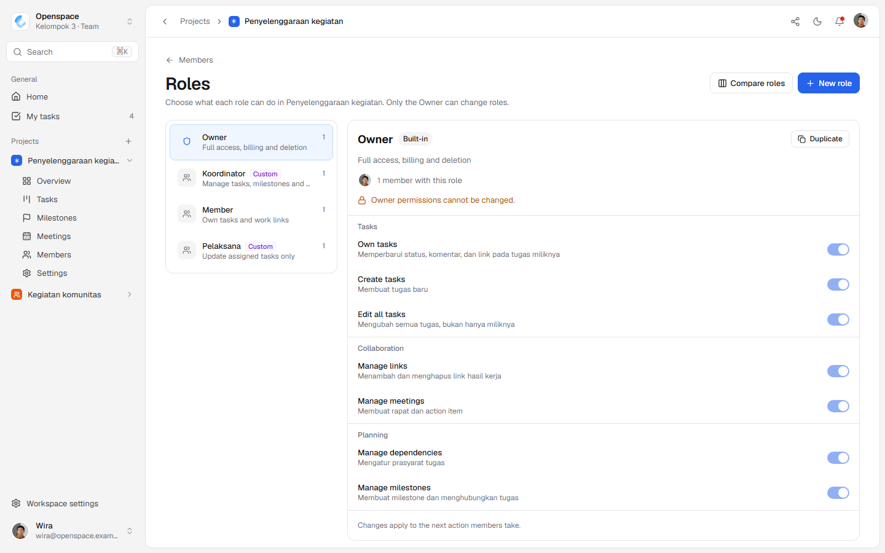
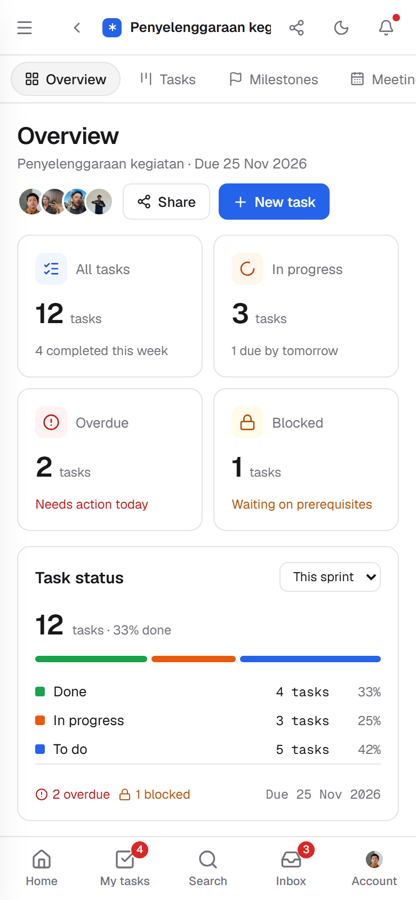
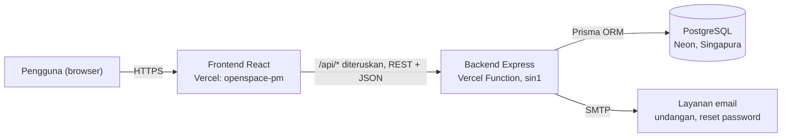

<div align="center">
  
  <h1>Openspace</h1>
  <p><strong>Satu ruang kerja untuk proyek kelompok. Tugas yang saling bergantung terlihat di Timeline, keputusan rapat langsung menjadi tugas, dan setiap anggota hanya bisa mengubah yang memang menjadi tanggung jawabnya.</strong></p>
  <p>
    <a href="https://openspace-pm.vercel.app"><strong>Live App</strong></a>
    &nbsp;|&nbsp;
    <a href="#5-penerapan-materi-rekayasa-perangkat-lunak"><strong>Penerapan Materi RPL</strong></a>
    &nbsp;|&nbsp;
    <a href="#4-tur-produk"><strong>Tur produk</strong></a>
    &nbsp;|&nbsp;
    <a href="#7-menjalankan-di-komputer-sendiri"><strong>Menjalankan</strong></a>
  </p>
  <p>
    <a href="https://react.dev/"></a>
    <a href="https://vite.dev/"></a>
    <a href="https://expressjs.com/"></a>
    <a href="https://www.prisma.io/"></a>
    <a href="https://neon.tech/"></a>
    <a href="https://jwt.io/"></a>
    <a href="https://vercel.com/"></a>
  </p>
</div>


| Prasyarat yang tidak bisa berputar                                                                                                                                                                | Rapat yang menjadi pekerjaan                                                                                                                                                                        | Izin per proyek                                                                                                                                                                    | Satu data, empat tampilan                                                                                                        |
| ------------------------------------------------------------------------------------------------------------------------------------------------------------------------------------------------- | --------------------------------------------------------------------------------------------------------------------------------------------------------------------------------------------------- | ---------------------------------------------------------------------------------------------------------------------------------------------------------------------------------- | -------------------------------------------------------------------------------------------------------------------------------- |
| Tugas bisa menunggu tugas lain. Hubungan yang membentuk siklus ditolak lewat penelusuran [DFS](backend/src/lib/taskRules.js), dan tugas yang masih menunggu tidak bisa dimulai atau diselesaikan. | Action item rapat dijadikan tugas dalam [satu transaksi](backend/src/routes/planning.routes.js). Satu action item paling banyak menghasilkan satu tugas, dan tugasnya tetap menunjuk ke rapat asal. | Owner menyusun custom role dari 7 izin. Setiap request diperiksa [middleware akses](backend/src/middleware/access.js); pengguna yang bukan anggota mendapat 404, bukan isi proyek. | Board, List, Calendar, dan Timeline membaca cache yang sama, jadi perubahan di satu tampilan langsung terlihat di tampilan lain. |

Capstone Project mata kuliah **Rekayasa Perangkat Lunak**, Kelompok 3, Program Studi Informatika, Universitas Udayana. Aplikasi berjalan di **https://openspace-pm.vercel.app**.

## 1. Deskripsi

Openspace adalah aplikasi web manajemen proyek untuk tim kecil: kelompok tugas kuliah, panitia kegiatan, atau tim kerja. Pengguna membuat workspace untuk timnya, lalu setiap proyek berisi anggota, tugas, prasyarat tugas, rapat, milestone, komentar, dan link hasil kerja.

Owner mengundang anggota lewat email dan memberi mereka role. Tugas bisa dilihat sebagai Board, List, Calendar, atau Timeline. Timeline menggambar garis ketergantungan, sehingga tugas yang terhambat langsung terlihat beserta penyebabnya. Dashboard Overview merangkum progres, keterlambatan, milestone berikutnya, dan beban kerja per anggota.

## 2. Masalah

Pekerjaan kelompok hampir selalu dibagi ke beberapa orang, saling bergantung, dan punya tenggat. Dari kajian pustaka di laporan dan pengalaman kelompok sendiri, ada empat celah yang sering muncul:

- **Ketergantungan tidak terlihat.** Materi baru bisa dicetak setelah desainnya disetujui. Kalau hubungan ini tidak dicatat, keterlambatan satu tugas merambat ke tugas lain tanpa disadari.
- **Keputusan rapat tidak menjadi pekerjaan.** Notulen dan daftar tugas disimpan terpisah, jadi tindak lanjut harus disalin ulang dan hubungannya dengan rapat hilang.
- **Beban kerja sulit dipantau.** Daftar deadline tidak memperlihatkan siapa yang memegang terlalu banyak tugas di minggu tertentu.
- **Hak akses tidak sesuai tanggung jawab.** Tanpa role, semua orang bisa mengubah apa saja, atau sebaliknya ketua harus mengerjakan semua perubahan sendiri.

## 3. Fitur

**Fitur inti:**

- **Akun dan workspace:** daftar sekaligus membuat workspace, login, reset password lewat email, profil dan preferensi notifikasi.
- **Proyek:** buat, ubah, urutkan, arsipkan (hanya-baca), hapus, dan alihkan kepemilikan.
- **Anggota dan role:** undangan email dengan role tujuan, kirim ulang dan batalkan undangan, ubah role, keluarkan anggota setelah tugas terbukanya dialihkan. Role bawaan Owner dan Member, ditambah custom role yang bisa dibuat, diubah, diduplikasi, dibandingkan, dan dihapus.
- **Tugas:** beberapa penanggung jawab, tanggal mulai, deadline, prioritas, status, milestone, komentar, dan link hasil kerja.
- **Prasyarat:** penanda "terhambat", garis ketergantungan di Timeline, dan penolakan hubungan ke diri sendiri, duplikat, lintas proyek, maupun yang membentuk siklus.
- **Rapat:** waktu, lokasi, peserta, catatan, dan action item yang bisa dijadikan tugas.
- **Milestone, Overview, My tasks, pencarian, filter, dan notifikasi** (penugasan, komentar, pengingat deadline H-1, undangan).

**Penyempurnaan antarmuka:**

- **Dark mode** dengan pilihan Light, Dark, atau mengikuti sistem.
- **Menu klik kanan** (juga tekan lama dan Shift+F10), tambah cepat, sembunyikan tugas, hapus dengan Undo, aksi massal, dan atur kolom di List.
- **Timeline interaktif:** seret bar untuk menggeser jadwal, seret tepinya untuk mengubah tanggal, tarik titik di ujung bar ke bar lain untuk membuat prasyarat.
- **Tampilan ponsel dan tablet:** navigasi bawah, laci menu, dan panel dari bawah layar.

## 4. Tur produk

Semua gambar diambil dari data contoh proyek "Penyelenggaraan kegiatan" yang dibuat oleh `npm run db:reset`.

### Empat tampilan tugas

| Board                                                                                                                                            | List                                                                                                                                                                           |
| ------------------------------------------------------------------------------------------------------------------------------------------------ | ------------------------------------------------------------------------------------------------------------------------------------------------------------------------------ |
|      |                                    |
| Kartu per status. Kartu yang terhambat menyebut tugas yang ditunggunya, dan tugas yang lewat deadline diberi label Overdue.                      | Tabel per kelompok status dengan kolom yang bisa diatur, pilihan banyak tugas, dan ganti judul langsung.                                                                       |
| **Calendar**                                                                                                                                     | **Timeline**                                                                                                                                                                   |
|  |  |
| Tugas, rapat, dan milestone pada tanggalnya, ditambah daftar tujuh hari ke depan.                                                                | Bar dari tanggal mulai sampai deadline. Garis putus-putus adalah prasyarat; bar bisa diseret untuk mengubah jadwal.                                                            |

### Detail tugas, rapat, dan milestone

| Detail tugas                                                                                                                 | Rapat                                                                                                                                                        |
| ---------------------------------------------------------------------------------------------------------------------------- | ------------------------------------------------------------------------------------------------------------------------------------------------------------ |
|  |  |
| Panel di sisi kanan: status, penanggung jawab, tanggal, prioritas, milestone, rapat asal, prasyarat, komentar, dan link.     | Peserta, catatan, dan action item. Action item yang sudah menjadi tugas menampilkan status tugas itu.                                                        |
| **Milestone**                                                                                                                | **Anggota**                                                                                                                                                  |
|     |                                       |
| Target proyek dengan penanggung jawab, deadline, dan progres dari tugas di dalamnya.                                         | Anggota, role, jumlah tugas terbuka, dan undangan yang masih tertunda.                                                                                       |

### Role, tema gelap, dan ponsel

| Role                                                                                                                                                     | Tema gelap                                                                                                                 |
| -------------------------------------------------------------------------------------------------------------------------------------------------------- | -------------------------------------------------------------------------------------------------------------------------- |
|  |                                                  |
| Daftar role di kiri, izin role terpilih di kanan. Izin Owner terkunci; Compare roles membandingkan semua role tanpa bisa mengubahnya.                    | Semua warna adalah token CSS, jadi tema gelap cukup mengganti nilai token.                                                 |
| **Overview di ponsel**                                                                                                                                   | **Board di ponsel**                                                                                                        |
|                                                                    |                      |
| Kartu ringkasan menjadi grid dua kolom, tab proyek bisa digeser di atas, dan navigasi utama pindah ke bawah layar.                                       | Kolom Board digeser ke samping, tombol + mengambang untuk tugas baru, dan navigasi Home, My tasks, Search, Inbox, Account. |

## 5. Penerapan Materi Rekayasa Perangkat Lunak

Bagian ini memetakan [materi kuliah](https://drive.google.com/drive/folders/1HN5IAR8tsiA-WGSGc8PtaxV2D2Hj8ErA) ke keputusan nyata di Openspace. Materinya mengikuti buku _Software Engineering_ edisi 7 karya Ian Sommerville. Setiap baris menunjuk ke kode, konfigurasi, atau riwayat repository yang bisa diperiksa. Rincian pengembangan lanjutan (kebutuhan tambahan, ISO/IEC 25010, aturan emas Shneiderman, dan 21 skenario black-box) ada di [`docs/Penerapan-Materi-RPL.md`](docs/Penerapan-Materi-RPL.md).

| Materi                     | Topik di slide                                                                               | Bagian                             |
| -------------------------- | -------------------------------------------------------------------------------------------- | ---------------------------------- |
| 1. Pengantar RPL           | Atribut perangkat lunak yang baik, tantangan RPL, tanggung jawab profesional dan etika, CASE | [5.1](#51-pengantar-rpl)           |
| 2. Socio-technical Systems | Emergent properties, jenis kebutuhan sistem, proses desain sistem, evolusi                   | [5.2](#52-socio-technical-systems) |
| 3. Software Processes      | Model proses, rekayasa kebutuhan, aktivitas desain, tahap pengujian, RUP, klasifikasi CASE   | [5.3](#53-software-processes)      |
| 4. Project Management      | Aktivitas manajemen, rencana proyek, milestone, penjadwalan, manajemen risiko                | [5.4](#54-project-management)      |

### 5.1 Pengantar RPL

**Atribut perangkat lunak yang baik.** Slide menyebut empat atribut: _maintainability_, _dependability_, _efficiency_, dan _acceptability_.

| Atribut         | Penerapan di Openspace                                                                                                                                                                                                                                                                                                                                                                                                          |
| --------------- | ------------------------------------------------------------------------------------------------------------------------------------------------------------------------------------------------------------------------------------------------------------------------------------------------------------------------------------------------------------------------------------------------------------------------------- |
| Maintainability | Monorepo dengan batas yang jelas: [`backend/`](backend) dan [`frontend/`](frontend). Aturan bisnis ditulis sebagai fungsi murni di [`taskRules.js`](backend/src/lib/taskRules.js) dan [`taskGuards.js`](frontend/src/lib/taskGuards.js), sehingga bisa diuji tanpa browser atau database. ESLint dan Prettier menjaga gaya kode, dan [`CONTRIBUTING.md`](CONTRIBUTING.md) mengatur branch, format commit, dan kepemilikan file. |
| Dependability   | Password disimpan sebagai hash bcrypt. Token reset password dan undangan hanya disimpan hash SHA-256-nya, sekali pakai, dan punya masa berlaku ([`tokens.js`](backend/src/lib/tokens.js)). Semua input divalidasi Zod, dan perubahan yang saling terkait dibungkus transaksi Prisma.                                                                                                                                            |
| Efficiency      | Empat tampilan tugas berbagi satu cache React Query, jadi data tugas tidak diambil ulang per tampilan. Backend berjalan di region Singapura (`sin1`), sedekat mungkin dengan database Neon.                                                                                                                                                                                                                                     |
| Acceptability   | Status selalu tampil sebagai ikon dan teks, bukan warna saja. Setiap penolakan menyebut alasannya, misalnya "Tugas ini masih menunggu: Persetujuan desain". Tersedia navigasi keyboard, tema gelap, dan tata letak ponsel.                                                                                                                                                                                                      |

**Tantangan RPL.** Slide menyebut _heterogeneity_, _delivery_, dan _trust_:

- **Heterogeneity:** aplikasi yang sama berjalan di desktop, tablet, ponsel, tema terang dan gelap, serta di dua lingkungan: laptop (PostgreSQL bawaan lewat `embedded-postgres`) dan cloud (Vercel serverless dengan Neon).
- **Delivery:** setiap fitur dikirim lewat branch kecil dan Pull Request. Merge ke `main` langsung memicu deploy production di Vercel.
- **Trust:** izin selalu diperiksa di backend; antarmuka hanya menonaktifkan tombol. Mematikan JavaScript atau memanggil API langsung tidak memberi akses tambahan.

**Tanggung jawab profesional.**

| Isu di slide                 | Penerapan                                                                                                                                                                                                              |
| ---------------------------- | ---------------------------------------------------------------------------------------------------------------------------------------------------------------------------------------------------------------------- |
| Confidentiality              | Data proyek hanya bisa dibaca anggotanya. Secret tidak pernah masuk repository: hanya [`backend/.env.example`](backend/.env.example) tanpa nilai asli, dan nilai production disimpan di pengaturan environment Vercel. |
| Competence                   | Keterbatasan sistem ditulis terbuka di [bagian 11](#11-keterbatasan). Klaim di README dan laporan dicocokkan dengan kode, misalnya jumlah uji unit dan aturan izin.                                                    |
| Intellectual property rights | Library, font, dan referensi dicantumkan beserta lisensinya di [bagian 10](#10-referensi-dan-kredit).                                                                                                                  |
| Computer misuse              | Percobaan login dibatasi per email ([`rateLimit.js`](backend/src/lib/rateLimit.js)), dan seed yang menghapus seluruh data menolak berjalan di production ([`seed.js`](backend/prisma/seed.js)).                        |

### 5.2 Socio-technical Systems

Openspace adalah sistem sosio-teknis: kegunaannya baru muncul ketika teknologi (aplikasi web), orang (Owner, Koordinator, Member), dan proses organisasi (rapat, pembagian tugas, tenggat) bekerja bersama. Contohnya, prasyarat tugas hanya berguna kalau tim memang mencatat urutan kerjanya.

**Jenis kebutuhan sistem.** Slide membagi kebutuhan menjadi tiga jenis. Daftar lengkapnya ada di laporan (FR-01 sampai FR-19 dan Tabel 2.3).

| Jenis                                       | Contoh di Openspace                                                                                                                                                                                                                                                  |
| ------------------------------------------- | -------------------------------------------------------------------------------------------------------------------------------------------------------------------------------------------------------------------------------------------------------------------- |
| Abstract functional requirements            | Mengelola proyek, anggota, tugas, prasyarat, rapat, milestone, dan notifikasi.                                                                                                                                                                                       |
| System properties (non-fungsional)          | Password di-hash, token sekali pakai, status tidak dibedakan hanya dengan warna, empat tampilan membaca data yang sama.                                                                                                                                              |
| Undesirable characteristics ("_shall-not_") | Pengguna **tidak boleh** melihat proyek yang bukan miliknya. Member **tidak boleh** mengubah tugas orang lain. Prasyarat **tidak boleh** membentuk siklus. Satu action item **tidak boleh** menghasilkan dua tugas. Role yang masih dipakai **tidak boleh** dihapus. |

**Emergent properties.** Keamanan Openspace bukan milik satu komponen. Keamanan muncul dari gabungan middleware akses, constraint unik di database (misalnya satu anggota hanya punya satu role per proyek), validasi input, dan antarmuka yang menonaktifkan aksi terlarang. Karena itu sifat seperti ini hanya bisa diuji setelah semua bagian terintegrasi: pengujian API dengan empat role dijalankan terhadap aplikasi yang berjalan, bukan per fungsi.

**Proses desain sistem.** Langkah di slide diterapkan sebagai berikut:

| Langkah                      | Hasil                                                                                                                        |
| ---------------------------- | ---------------------------------------------------------------------------------------------------------------------------- |
| Partition requirements       | Kebutuhan dikelompokkan: akun, proyek dan anggota, role dan izin, tugas, kolaborasi, rapat, notifikasi.                      |
| Identify sub-systems         | Frontend React, backend REST API, database PostgreSQL, layanan email.                                                        |
| Assign requirements          | Pemeriksaan izin dan aturan bisnis di backend; penyajian dan interaksi di frontend; integritas relasi di database.           |
| Define sub-system interfaces | REST API dengan JSON antara frontend dan backend, Prisma antara backend dan database, SMTP antara backend dan layanan email. |

Model arsitekturnya digambarkan sebagai diagram blok, seperti yang dianjurkan slide _System modelling_:



**Evolusi sistem.** Skema database berubah lewat migrasi bertahap yang tercatat di [`backend/prisma/migrations`](backend/prisma/migrations) (init, lalu avatar pengguna, lalu ikon proyek). Lingkungan deploy juga berevolusi dari rencana Render ke Vercel tanpa mengubah perilaku aplikasi (lihat risiko T1 di [5.4](#54-project-management)). Untuk _decommissioning_, proyek bisa diarsipkan menjadi hanya-baca sebelum dihapus, dan penghapusan menghapus data turunan dengan urutan yang menjaga relasi.

### 5.3 Software Processes

**Model proses: inkremental dengan prototyping.** Rancangan antarmuka dibuat lebih dulu sebagai prototipe Figma untuk menjelaskan kebutuhan. Setelah itu sistem dikirim per inkremen, sesuai slide _Incremental delivery_: kebutuhan prioritas tinggi dikerjakan lebih dulu, dan setiap inkremen menghasilkan perangkat lunak yang tetap bisa dijalankan.

| Inkremen           | Pull Request   | Isi                                                                                                                                     |
| ------------------ | -------------- | --------------------------------------------------------------------------------------------------------------------------------------- |
| 1. Fondasi backend | #1 sampai #6   | Setup Express, skema Prisma dan migrasi, autentikasi JWT, pemeriksaan izin, endpoint proyek, anggota, role, tugas, milestone, dan rapat |
| 2. Antarmuka       | #7 sampai #16  | Setup Vite, komponen UI, layout dan routing, halaman auth, empat tampilan tugas, Overview, Milestones, Meetings, Members, Roles         |
| 3. Siap production | #17 sampai #22 | Pengamanan akun (pembatasan login, password untuk ganti email), deploy backend dan frontend di Vercel, rilis ke `main`                  |
| 4. Penyempurnaan   | #23 sampai #25 | Dark mode, menu klik kanan, Timeline interaktif, tampilan ponsel, transisi, 43 uji unit                                                 |

Setiap inkremen melewati Pull Request ke `develop`, lalu dirilis ke `main`. Pull Request dan riwayat commit-nya bisa ditelusuri di tab [Pull requests](https://github.com/agvswira/openspace/pulls?q=is%3Apr+is%3Amerged).

**Rekayasa kebutuhan.** Empat tahap di slide:

1. **Feasibility study:** cakupan dipilih sesuai kemampuan tim dan layanan gratis yang tersedia. Rapat dicatat manual, hasil kerja disimpan sebagai link (bukan unggahan berkas), dan tidak ada chat langsung antaranggota.
2. **Elicitation and analysis:** studi pustaka, analisis aplikasi sejenis, dan diskusi kelompok.
3. **Specification:** kebutuhan fungsional FR-01 sampai FR-19, kebutuhan non-fungsional, dan aturan fitur di Bab II laporan.
4. **Validation:** prototipe Figma ditinjau sebelum fitur dibuat. Masukan dosen ditampung sebagai inkremen baru lewat branch fitur, bukan dengan mengubah rilis yang sudah berjalan.

**Aktivitas desain.** Enam aktivitas di slide dan artefaknya:

| Aktivitas              | Artefak                                                                                                                                                                                    |
| ---------------------- | ------------------------------------------------------------------------------------------------------------------------------------------------------------------------------------------ |
| Architectural design   | Pembagian frontend, backend, database, dan email (diagram di [5.2](#52-socio-technical-systems))                                                                                           |
| Abstract specification | Aturan fitur: tugas terhambat tidak bisa dimulai, tugas Done tidak dibuka kembali bila tugas lanjutannya sudah berjalan, dan sebagainya                                                    |
| Interface design       | Kontrak REST API di [`backend/src/routes`](backend/src/routes)                                                                                                                             |
| Component design       | Komponen React yang dipakai ulang di [`frontend/src/components/ui`](frontend/src/components/ui), misalnya `Modal`, `Menu`, dan [`ContextMenu`](frontend/src/components/ui/ContextMenu.jsx) |
| Data structure design  | 19 model di [`schema.prisma`](backend/prisma/schema.prisma)                                                                                                                                |
| Algorithm design       | Deteksi siklus prasyarat dengan DFS ([`findCyclePath`](backend/src/lib/taskRules.js)), progres dihitung dari jumlah tugas Done dibagi seluruh tugas                                        |

**Verifikasi dan validasi.** Tahap pengujian di slide:

| Tahap                    | Penerapan                                                                                                                                                                     | Status                                                                              |
| ------------------------ | ----------------------------------------------------------------------------------------------------------------------------------------------------------------------------- | ----------------------------------------------------------------------------------- |
| Component (unit) testing | 43 uji unit dengan `node:test`: aturan tugas, katalog izin, serializer (termasuk memastikan `passwordHash` tidak bocor), dan logika seret Timeline. Jalankan `npm test`.      | 43 lulus                                                                            |
| System testing           | Uji API terhadap aplikasi yang berjalan dengan empat role, 21 skenario black-box di browser, dan simulasi production (database kosong, `NODE_ENV=production`) sebelum deploy. | Lulus, rinciannya di [`docs/Penerapan-Materi-RPL.md`](docs/Penerapan-Materi-RPL.md) |
| Acceptance testing       | User Acceptance Testing bersama calon pengguna.                                                                                                                               | Direncanakan                                                                        |

Sebelum setiap Pull Request, `npm run lint`, `npm run format:check`, `npm test`, dan `npm run build` dijalankan.

**Praktik baik RUP.**

| Praktik                           | Penerapan                                                                                                                |
| --------------------------------- | ------------------------------------------------------------------------------------------------------------------------ |
| Develop software iteratively      | Empat inkremen di atas                                                                                                   |
| Manage requirements               | Kebutuhan diberi kode (FR-01 dan seterusnya) dan dirujuk dari pengujian                                                  |
| Use component-based architectures | Komponen UI yang dipakai ulang di frontend; route, middleware, dan lib yang terpisah di backend                          |
| Visually model software           | Use case, class, sequence, activity diagram, dan ERD di Bab II laporan                                                   |
| Verify software quality           | Uji unit, uji sistem, lint, dan build sebelum merge                                                                      |
| Control changes to software       | Branch per fitur, Pull Request ke `develop`, rilis ke `main`, merge commit (bukan squash) agar riwayat tiap anggota utuh |

**Alat CASE.** Klasifikasi fungsional di slide dan alat yang dipakai tim:

| Jenis alat                     | Alat                                                                |
| ------------------------------ | ------------------------------------------------------------------- |
| Planning tools                 | Openspace sendiri dan GitHub Pull Requests                          |
| Editing tools                  | Visual Studio Code, Figma                                           |
| Configuration management tools | Git, GitHub, Prisma Migrate                                         |
| Prototyping tools              | Figma (wireframe dan prototipe interaktif)                          |
| Method-support tools           | Prisma (skema data menjadi query client dan migrasi), Prisma Studio |
| Language-processing tools      | Node.js, Vite (build frontend)                                      |
| Program analysis tools         | ESLint                                                              |
| Testing tools                  | `node:test`                                                         |
| Documentation tools            | Markdown (README, CONTRIBUTING, dokumen penerapan materi)           |

### 5.4 Project Management

Materi ini diterapkan dua kali: sebagai **fitur** Openspace dan sebagai **cara tim mengelola** proyek Openspace sendiri.

**Konsep manajemen proyek sebagai fitur.**

| Konsep di slide                                     | Fitur Openspace                                                                |
| --------------------------------------------------- | ------------------------------------------------------------------------------ |
| Milestones: titik akhir aktivitas yang bisa dinilai | Halaman Milestones dengan deadline, penanggung jawab, dan progres              |
| Bar charts                                          | Timeline: setiap tugas digambar sebagai bar dari tanggal mulai sampai deadline |
| Activity networks, task dependencies                | Prasyarat tugas dengan garis putus-putus di Timeline dan penanda "terhambat"   |
| Staff allocation                                    | Kartu _Workload by assignee_ di Overview                                       |
| Project monitoring and reviews                      | Overview: progres, tugas terlambat, terhambat, dan perlu perhatian             |
| Progress meetings                                   | Halaman Meetings dengan action item yang menjadi tugas                         |
| Personnel selection                                 | Owner memilih anggota dan menetapkan role sesuai tanggung jawab                |

**Rencana proyek tim.** Struktur rencana proyek di slide dan isinya:

| Bagian rencana                  | Isi untuk Openspace                                                                                  |
| ------------------------------- | ---------------------------------------------------------------------------------------------------- |
| Introduction                    | Latar belakang, rumusan masalah, dan tujuan di Bab I laporan                                         |
| Project organisation            | Empat anggota dengan area kode masing-masing ([bagian 9](#9-tim))                                    |
| Risk analysis                   | Tabel risiko di bawah                                                                                |
| Hardware and software resources | Layanan gratis: Vercel Hobby, Neon Free, Gmail SMTP                                                  |
| Work breakdown                  | Area kode per anggota di [`CONTRIBUTING.md`](CONTRIBUTING.md), dipecah lagi menjadi branch per fitur |
| Project schedule                | Urutan merge: backend, fondasi frontend, halaman, deploy, penyempurnaan                              |
| Monitoring and reporting        | Review Pull Request, status deploy di Vercel, dan rapat kelompok                                     |

**Manajemen risiko.** Risiko diidentifikasi dengan lima kategori di slide, dianalisis peluang dan dampaknya, lalu diberi strategi _avoidance_, _minimisation_, atau _contingency_. Sebagian risiko di bawah benar-benar terjadi selama pengerjaan.

| ID  | Risiko                                                                | Jenis          | Peluang | Dampak       | Strategi                                                                           | Hasil                                                                     |
| --- | --------------------------------------------------------------------- | -------------- | ------- | ------------ | ---------------------------------------------------------------------------------- | ------------------------------------------------------------------------- |
| T1  | Layanan hosting backend gratis ternyata meminta kartu pembayaran      | Technology     | Tinggi  | Serius       | Contingency: pindah ke Vercel Functions                                            | Terjadi. Kartu ditolak Render, backend dipindah ke Vercel (#19)           |
| T2  | Layanan email tidak bisa mengirim ke alamat lain tanpa domain sendiri | Technology     | Tinggi  | Serius       | Contingency: Gmail SMTP dengan App Password                                        | Terjadi pada Resend, diganti Gmail SMTP                                   |
| T3  | Database gratis tidur saat tidak dipakai, request pertama lambat      | Technology     | Tinggi  | Tolerable    | Minimisation: backend dan database di region yang sama, buka aplikasi sebelum demo | Diterima                                                                  |
| T4  | Seed tidak sengaja dijalankan di production dan menghapus semua akun  | Organisational | Rendah  | Catastrophic | Avoidance: seed menolak `NODE_ENV=production` (#17)                                | Dicegah                                                                   |
| T5  | Akun dibobol dengan menebak password                                  | Technology     | Moderat | Serius       | Minimisation: batas 10 percobaan gagal per email per 15 menit (#17)                | Dicegah                                                                   |
| P1  | Anggota berhalangan saat bagiannya dibutuhkan                         | People         | Moderat | Serius       | Contingency: kepemilikan file tercatat dan perubahan lintas area lewat review PR   | Perubahan lintas area ditandai untuk direview pemiliknya, misalnya di #24 |
| R1  | Kebutuhan berubah setelah masukan dosen                               | Requirements   | Tinggi  | Tolerable    | Minimisation: pengembangan inkremental, branch per fitur, preview deployment       | Berlangsung lewat inkremen berikutnya                                     |
| E1  | Cakupan terlalu besar untuk satu semester                             | Estimation     | Moderat | Serius       | Avoidance: fitur prioritas dikerjakan lebih dulu, cakupan dibatasi di Bab I        | Fitur inti selesai                                                        |

Slide _Scheduling problems_ juga terbukti: masalah yang tidak terduga selalu muncul (T1 dan T2), jadi rencana deploy perlu cadangan waktu.

## 6. Arsitektur dan struktur repository

```text
Per request
  Browser        halaman React; data diambil lewat React Query
  /api/*         diteruskan Vercel dari domain frontend ke backend (frontend/vercel.json)
  Express        requireAuth (JWT) → projectAccess (keanggotaan) → requirePermission (izin role)
                 → validate (Zod) → handler
  Prisma         query dan transaksi ke PostgreSQL
  Nodemailer     undangan dan reset password lewat SMTP
```

```text
openspace/
├── backend/
│   ├── prisma/           schema.prisma, migrasi, data contoh (seed.js)
│   ├── scripts/          dev.js (PostgreSQL bawaan), studio.js, sync-permissions.js
│   ├── src/
│   │   ├── routes/       auth, me, projects, members, roles, tasks, planning
│   │   ├── middleware/   auth (JWT), access (RBAC), validate (Zod), error
│   │   └── lib/          aturan tugas, izin, token, email, notifikasi, rate limit
│   ├── test/             uji unit backend
│   └── vercel.json       region sin1 dan perintah build
├── frontend/
│   ├── src/
│   │   ├── pages/        Home, My tasks, Overview, Tasks, Milestones, Meetings, Members, Roles, Settings
│   │   ├── components/   layout, tasks (Board, List, Calendar, Timeline), ui
│   │   ├── context/      autentikasi, tema, toast
│   │   ├── api/          axios client dan hook React Query
│   │   └── lib/          format, status, aturan seret Timeline
│   ├── test/             uji unit frontend
│   └── vercel.json       rewrite /api ke backend
├── docs/                 penerapan materi RPL, PDF penjelasan, gambar README
└── Jalankan-Openspace.bat
```

| Lapisan  | Teknologi                                                                                                     |
| -------- | ------------------------------------------------------------------------------------------------------------- |
| Frontend | React 19, Vite 7, React Router 7, TanStack React Query 5, Axios, Lucide icons                                 |
| Backend  | Node.js, Express 5, JSON Web Token, bcryptjs, Zod, Nodemailer                                                 |
| Database | PostgreSQL lewat Prisma ORM 6. Saat pengembangan, PostgreSQL 18 dijalankan otomatis lewat `embedded-postgres` |
| Hosting  | Vercel (frontend dan backend, region Singapura), Neon Postgres (Singapura)                                    |

## 7. Menjalankan di komputer sendiri

Butuh **Node.js 20 atau lebih baru**. PostgreSQL tidak perlu diinstal.

**Cara cepat (Windows):** klik dua kali `Jalankan-Openspace.bat`. Saat pertama kali dijalankan, file ini menginstal dependensi (butuh internet, beberapa menit). Setelah itu browser terbuka di http://localhost:5180. Tutup jendela hitamnya untuk menghentikan aplikasi.

**Windows, macOS, atau Linux:**

```bash
npm run setup
```

```bash
npm run dev
```

Lalu buka **http://localhost:5180**. `npm run dev` menjalankan dua proses:

- `api` (port 4000): menyalakan PostgreSQL bawaan di port 5433, menerapkan migrasi, mengisi data contoh bila database masih kosong, lalu menjalankan REST API.
- `web` (port 5180): Vite dev server. Permintaan `/api` diteruskan ke port 4000.

**Akun demo lokal.** Semua memakai password `password123`. Akun ini hanya ada di database lokal, tidak di aplikasi live.

| Email                       | Role di proyek "Penyelenggaraan kegiatan" |
| --------------------------- | ----------------------------------------- |
| wira@openspace.example      | Owner                                     |
| nata@openspace.example      | Koordinator (custom role)                 |
| semaya@openspace.example    | Member                                    |
| megadhana@openspace.example | Pelaksana (custom role)                   |

Login dengan akun berbeda untuk mencoba pembatasan akses, misalnya Member tidak bisa membuat tugas.

| Perintah               | Fungsi                                                              |
| ---------------------- | ------------------------------------------------------------------- |
| `npm run db:reset`     | Menghapus database lokal dan mengisi ulang data contoh              |
| `npm run db:studio`    | Membuka Prisma Studio untuk melihat isi tabel                       |
| `npm test`             | Menjalankan 43 uji unit backend dan frontend                        |
| `npm run lint`         | Memeriksa kode dengan ESLint                                        |
| `npm run format:check` | Memeriksa format dengan Prettier (`npm run format` untuk merapikan) |
| `npm run build`        | Build frontend untuk produksi (`frontend/dist`)                     |

Tanpa `SMTP_HOST`, email undangan dan reset password dicetak di terminal `api`, sehingga tautannya bisa langsung disalin ke browser.

## 8. Variabel environment dan deployment

Nama variabel ada di [`backend/.env.example`](backend/.env.example). Saat `npm run dev` pertama kali dijalankan, `backend/.env` dibuat otomatis dengan `JWT_SECRET` acak. File `.env` diabaikan git, dan nilai production hanya disimpan di pengaturan Vercel.

| Variabel                                                        | Fungsi                                                                     |
| --------------------------------------------------------------- | -------------------------------------------------------------------------- |
| `API_PORT`                                                      | Port REST API lokal. Di Vercel tidak diisi                                 |
| `CLIENT_URL`                                                    | Alamat frontend, untuk CORS dan tautan di email                            |
| `USE_EMBEDDED_DB`, `EMBEDDED_DB_PORT`                           | `true` menjalankan PostgreSQL bawaan; `false` memakai `DATABASE_URL`       |
| `DATABASE_URL`                                                  | Koneksi PostgreSQL                                                         |
| `JWT_SECRET`, `JWT_EXPIRES_IN`                                  | Kunci dan masa berlaku token login. `JWT_SECRET` wajib diisi di production |
| `SMTP_HOST`, `SMTP_PORT`, `SMTP_USER`, `SMTP_PASS`, `MAIL_FROM` | Pengiriman email. Gunakan port 587                                         |

**Deployment.** Repository dihubungkan ke dua project Vercel dengan production branch `main`:

| Project  | Root directory | Isi                                                                                                                                                                                                 |
| -------- | -------------- | --------------------------------------------------------------------------------------------------------------------------------------------------------------------------------------------------- |
| Frontend | `frontend`     | Build Vite. [`frontend/vercel.json`](frontend/vercel.json) meneruskan `/api/*` ke backend dan mengarahkan path lain ke `index.html`                                                                 |
| Backend  | `backend`      | Express sebagai satu Vercel Function. [`backend/vercel.json`](backend/vercel.json) memilih region `sin1` dan menjalankan `prisma generate`, `prisma migrate deploy`, lalu sinkronisasi katalog izin |

Database production dimulai kosong; seed tidak pernah dijalankan di sana. Akun pertama dibuat lewat halaman Register.

## 9. Tim

| Nama                                   | GitHub                                                | Area utama di repository                                                                                  |
| -------------------------------------- | ----------------------------------------------------- | --------------------------------------------------------------------------------------------------------- |
| Komang Agus Wira Adnyana (koordinator) | [agvswira](https://github.com/agvswira)               | Backend (Express, Prisma, autentikasi, RBAC, aturan tugas), pengamanan akun, deployment                   |
| Ida Bagus Pradnya Subhiksa Semaya      | [gussubhiksa-png](https://github.com/gussubhiksa-png) | Fondasi frontend: setup Vite, API client, komponen UI, layout dan routing, halaman auth, Home, Settings   |
| I Gede Bagus Nata Krisnu               | [gnk969](https://github.com/gnk969)                   | Overview, Milestones, Meetings, Members, Roles; dark mode, Timeline interaktif, tampilan ponsel, uji unit |
| I Made Megadhana                       | [mademegadhana](https://github.com/mademegadhana)     | Komponen tugas: Board, List, Calendar, Timeline, panel detail, form tugas, My tasks                       |

Alur kerja tim, format commit, dan pembagian file ada di [`CONTRIBUTING.md`](CONTRIBUTING.md).

## 10. Referensi dan kredit

- **Materi kuliah:** I. Sommerville, _Software Engineering_, 7th ed. Addison-Wesley, 2004, Bab 1, 2, 4, dan 5 ([folder materi](https://drive.google.com/drive/folders/1HN5IAR8tsiA-WGSGc8PtaxV2D2Hj8ErA)).
- **Library:** React, React Router, TanStack Query, Axios, Vite, Express, Zod, jsonwebtoken, cors, dan embedded-postgres (MIT); Prisma (Apache-2.0); bcryptjs (BSD-3-Clause); dotenv (BSD-2-Clause); Nodemailer (MIT-0); Lucide icons (ISC).
- **Font:** Geist dan Geist Mono dari Google Fonts (SIL Open Font License).
- **Infrastruktur:** Vercel, Neon Postgres.
- **Data contoh:** proyek "Penyelenggaraan kegiatan" dan tokohnya dibuat tim untuk demo.

## 11. Keterbatasan

- **Pembatasan login disimpan di memori server.** Di Vercel, setiap instance punya hitungannya sendiri, jadi batasnya tidak seketat di satu server. Orang lain juga bisa sengaja mengunci login sebuah email selama 15 menit.
- **Email akun belum diverifikasi.** Karena itu token undangan hanya dikirim ke kotak masuk email, tidak ke notifikasi di aplikasi.
- **Sesi lama tetap berlaku sampai 7 hari** setelah password direset.
- **Layanan gratis:** Gmail SMTP dibatasi sekitar 500 email per hari dan kadang masuk folder Spam; database Neon tidur saat lama tidak dipakai.
- **Bundle JavaScript frontend** masih satu berkas di atas 500 kB; halaman belum dipecah dengan _lazy loading_.
- **User Acceptance Testing** belum dilaksanakan.
