<div align="center">
  
  <h1>Openspace</h1>
  <p><strong>Satu ruang kerja untuk proyek kelompok. Tugas yang saling bergantung terlihat di Timeline, keputusan rapat langsung menjadi tugas, dan setiap anggota hanya bisa mengubah yang memang menjadi tanggung jawabnya.</strong></p>
  <p>
    <a href="https://openspace-pm.vercel.app"><strong>Live App</strong></a>
    &nbsp;|&nbsp;
    <a href="#5-cara-openspace-dibangun"><strong>Cara dibangun</strong></a>
    &nbsp;|&nbsp;
    <a href="#4-tur-produk"><strong>Tur produk</strong></a>
    &nbsp;|&nbsp;
    <a href="#7-menjalankan-di-komputer-sendiri"><strong>Menjalankan</strong></a>
  </p>
  <p>
    <a href="https://react.dev/"></a>
    <a href="https://vite.dev/"></a>
    <a href="https://expressjs.com/"></a>
    <a href="https://www.prisma.io/"></a>
    <a href="https://neon.tech/"></a>
    <a href="https://jwt.io/"></a>
    <a href="https://vercel.com/"></a>
  </p>
</div>

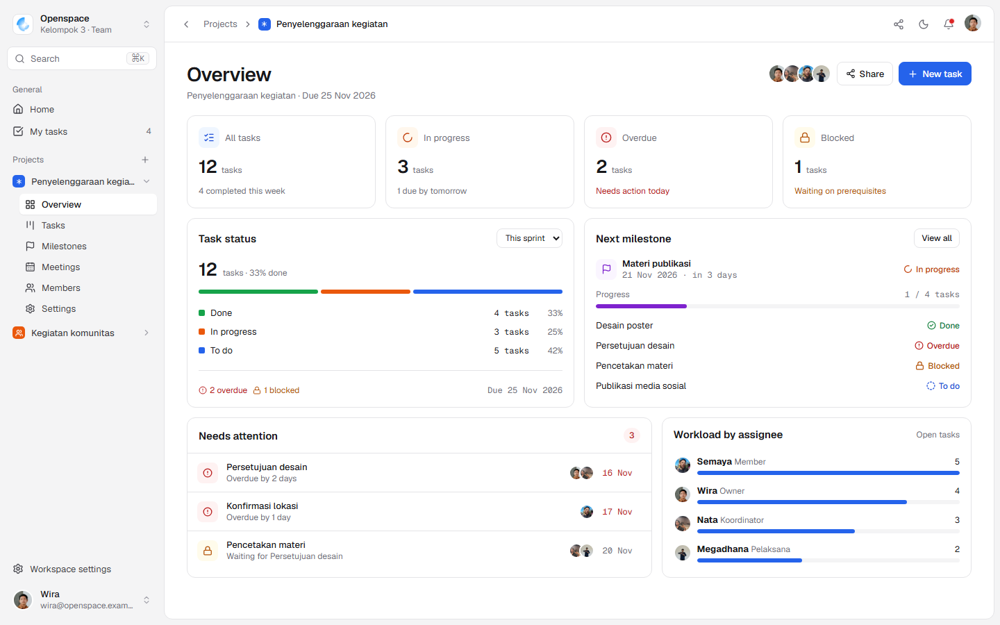

| Prasyarat yang tidak bisa berputar                                                                                                                                                                | Rapat yang menjadi pekerjaan                                                                                                                                                                        | Izin per proyek                                                                                                                                                                    | Satu data, empat tampilan                                                                                                        |
| ------------------------------------------------------------------------------------------------------------------------------------------------------------------------------------------------- | --------------------------------------------------------------------------------------------------------------------------------------------------------------------------------------------------- | ---------------------------------------------------------------------------------------------------------------------------------------------------------------------------------- | -------------------------------------------------------------------------------------------------------------------------------- |
| Tugas bisa menunggu tugas lain. Hubungan yang membentuk siklus ditolak lewat penelusuran [DFS](backend/src/lib/taskRules.js), dan tugas yang masih menunggu tidak bisa dimulai atau diselesaikan. | Action item rapat dijadikan tugas dalam [satu transaksi](backend/src/routes/planning.routes.js). Satu action item paling banyak menghasilkan satu tugas, dan tugasnya tetap menunjuk ke rapat asal. | Owner menyusun custom role dari 7 izin. Setiap request diperiksa [middleware akses](backend/src/middleware/access.js); pengguna yang bukan anggota mendapat 404, bukan isi proyek. | Board, List, Calendar, dan Timeline membaca cache yang sama, jadi perubahan di satu tampilan langsung terlihat di tampilan lain. |

Capstone Project mata kuliah **Rekayasa Perangkat Lunak**, Kelompok 3, Program Studi Informatika, Universitas Udayana. Aplikasi berjalan di **https://openspace-pm.vercel.app**.

## 1. Deskripsi

Openspace adalah aplikasi web manajemen proyek untuk tim kecil: kelompok tugas kuliah, panitia kegiatan, atau tim kerja. Pengguna membuat workspace untuk timnya, lalu setiap proyek berisi anggota, tugas, prasyarat tugas, rapat, milestone, komentar, dan link hasil kerja.

Owner mengundang anggota lewat email dan memberi mereka role. Tugas bisa dilihat sebagai Board, List, Calendar, atau Timeline. Timeline menggambar garis ketergantungan, sehingga tugas yang terhambat langsung terlihat beserta penyebabnya. Dashboard Overview merangkum progres, keterlambatan, milestone berikutnya, dan beban kerja per anggota.

## 2. Masalah

Pekerjaan kelompok hampir selalu dibagi ke beberapa orang, saling bergantung, dan punya tenggat. Dari kajian pustaka di laporan dan pengalaman kelompok sendiri, ada empat celah yang sering muncul:

- **Ketergantungan tidak terlihat.** Materi baru bisa dicetak setelah desainnya disetujui. Kalau hubungan ini tidak dicatat, keterlambatan satu tugas merambat ke tugas lain tanpa disadari.
- **Keputusan rapat tidak menjadi pekerjaan.** Notulen dan daftar tugas disimpan terpisah, jadi tindak lanjut harus disalin ulang dan hubungannya dengan rapat hilang.
- **Beban kerja sulit dipantau.** Daftar deadline tidak memperlihatkan siapa yang memegang terlalu banyak tugas di minggu tertentu.
- **Hak akses tidak sesuai tanggung jawab.** Tanpa role, semua orang bisa mengubah apa saja, atau sebaliknya ketua harus mengerjakan semua perubahan sendiri.

## 3. Fitur

**Fitur inti:**

- **Akun dan workspace:** daftar sekaligus membuat workspace, login, reset password lewat email, profil dan preferensi notifikasi.
- **Proyek:** buat, ubah, urutkan, arsipkan (hanya-baca), hapus, dan alihkan kepemilikan.
- **Anggota dan role:** undangan email dengan role tujuan, kirim ulang dan batalkan undangan, ubah role, keluarkan anggota setelah tugas terbukanya dialihkan. Role bawaan Owner dan Member, ditambah custom role yang bisa dibuat, diubah, diduplikasi, dibandingkan, dan dihapus.
- **Tugas:** beberapa penanggung jawab, tanggal mulai, deadline, prioritas, status, milestone, komentar, dan link hasil kerja.
- **Prasyarat:** penanda "terhambat", garis ketergantungan di Timeline, dan penolakan hubungan ke diri sendiri, duplikat, lintas proyek, maupun yang membentuk siklus.
- **Rapat:** waktu, lokasi, peserta, catatan, dan action item yang bisa dijadikan tugas.
- **Milestone, Overview, My tasks, pencarian, filter, dan notifikasi** (penugasan, komentar, pengingat deadline H-1, undangan).

**Penyempurnaan antarmuka:**

- **Dark mode** dengan pilihan Light, Dark, atau mengikuti sistem.
- **Menu klik kanan** (juga tekan lama dan Shift+F10), tambah cepat, sembunyikan tugas, hapus dengan Undo, aksi massal, dan atur kolom di List.
- **Timeline interaktif:** seret bar untuk menggeser jadwal, seret tepinya untuk mengubah tanggal, tarik titik di ujung bar ke bar lain untuk membuat prasyarat.
- **Tampilan ponsel dan tablet:** navigasi bawah, laci menu, dan panel dari bawah layar.

## 4. Tur produk

Semua gambar diambil dari data contoh proyek "Penyelenggaraan kegiatan" yang dibuat oleh `npm run db:reset`.

### Empat tampilan tugas

| Board                                                                                                                                            | List                                                                                                                                                                           |
| ------------------------------------------------------------------------------------------------------------------------------------------------ | ------------------------------------------------------------------------------------------------------------------------------------------------------------------------------ |
| 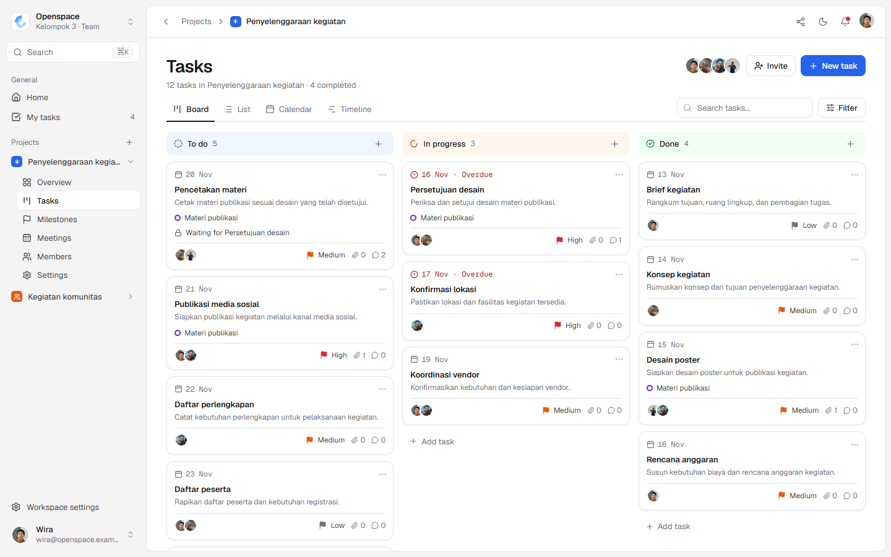     |                                    |
| Kartu per status. Kartu yang terhambat menyebut tugas yang ditunggunya, dan tugas yang lewat deadline diberi label Overdue.                      | Tabel per kelompok status dengan kolom yang bisa diatur, pilihan banyak tugas, dan ganti judul langsung.                                                                       |
| **Calendar**                                                                                                                                     | **Timeline**                                                                                                                                                                   |
|  | 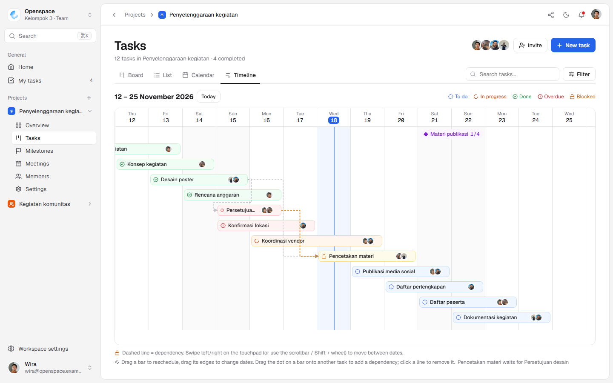 |
| Tugas, rapat, dan milestone pada tanggalnya, ditambah daftar tujuh hari ke depan.                                                                | Bar dari tanggal mulai sampai deadline. Garis putus-putus adalah prasyarat; bar bisa diseret untuk mengubah jadwal.                                                            |

### Detail tugas, rapat, dan milestone

| Detail tugas                                                                                                                 | Rapat                                                                                                                                                        |
| ---------------------------------------------------------------------------------------------------------------------------- | ------------------------------------------------------------------------------------------------------------------------------------------------------------ |
| 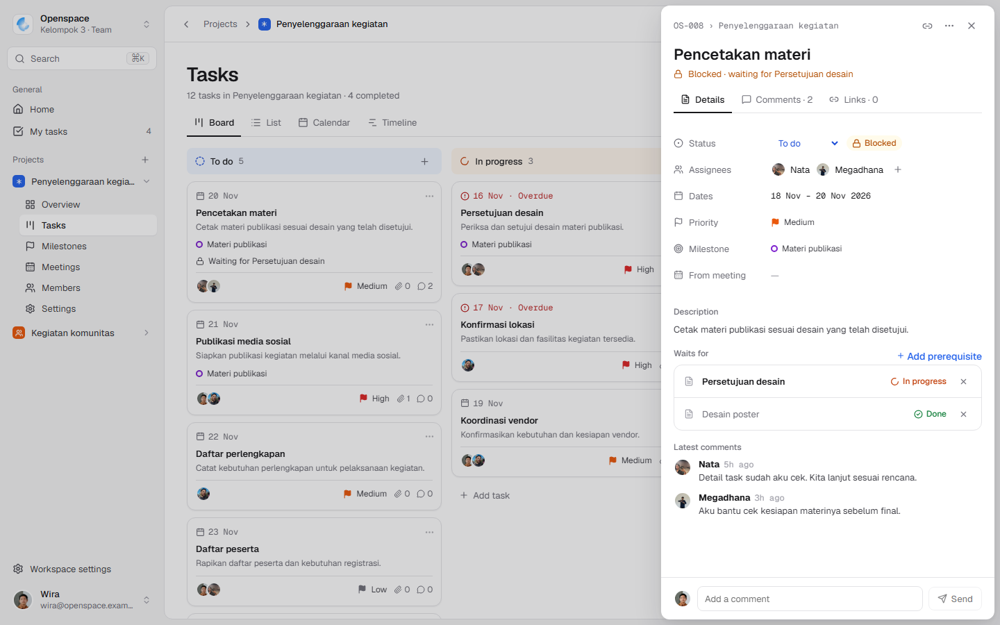 |  |
| Panel di sisi kanan: status, penanggung jawab, tanggal, prioritas, milestone, rapat asal, prasyarat, komentar, dan link.     | Peserta, catatan, dan action item. Action item yang sudah menjadi tugas menampilkan status tugas itu.                                                        |
| **Milestone**                                                                                                                | **Anggota**                                                                                                                                                  |
|     | 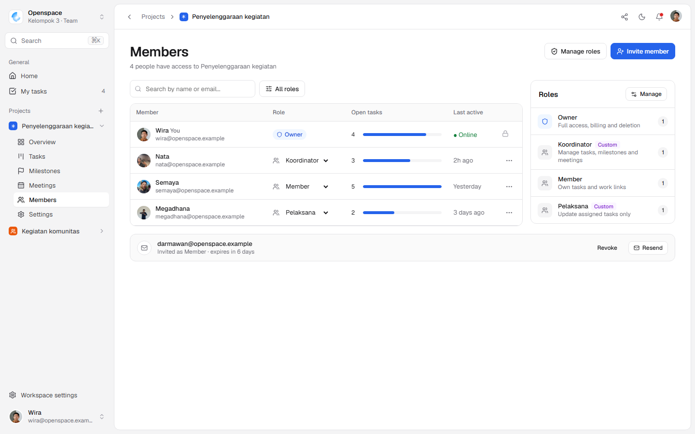                                      |
| Target proyek dengan penanggung jawab, deadline, dan progres dari tugas di dalamnya.                                         | Anggota, role, jumlah tugas terbuka, dan undangan yang masih tertunda.                                                                                       |

### Role, tema gelap, dan ponsel

| Role                                                                                                                                                     | Tema gelap                                                                                                                 |
| -------------------------------------------------------------------------------------------------------------------------------------------------------- | -------------------------------------------------------------------------------------------------------------------------- |
|  | 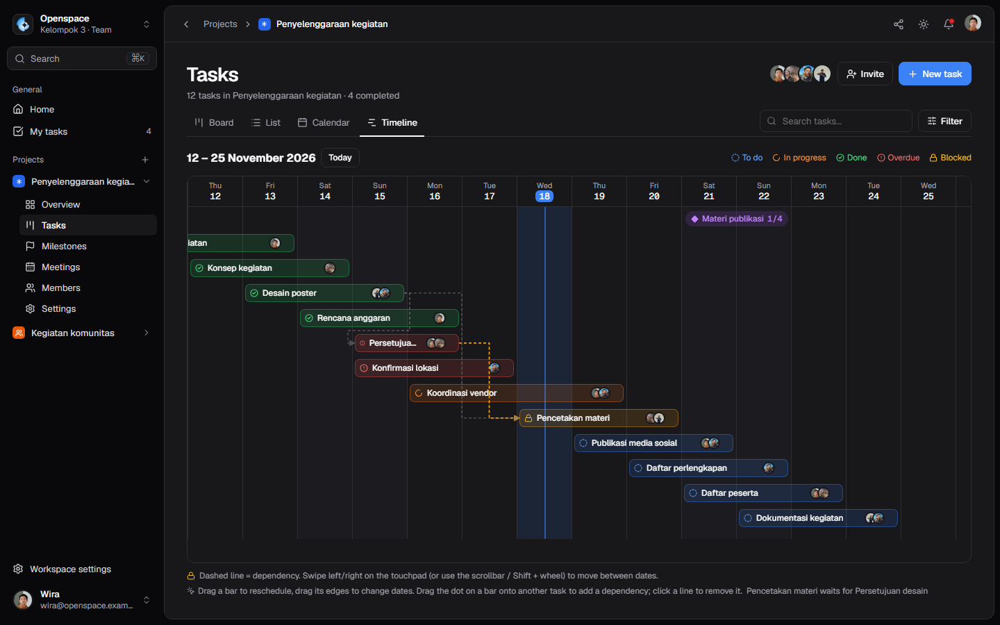                                                 |
| Daftar role di kiri, izin role terpilih di kanan. Izin Owner terkunci; Compare roles membandingkan semua role tanpa bisa mengubahnya.                    | Semua warna adalah token CSS, jadi tema gelap cukup mengganti nilai token.                                                 |
| **Overview di ponsel**                                                                                                                                   | **Board di ponsel**                                                                                                        |
|                                                                    | 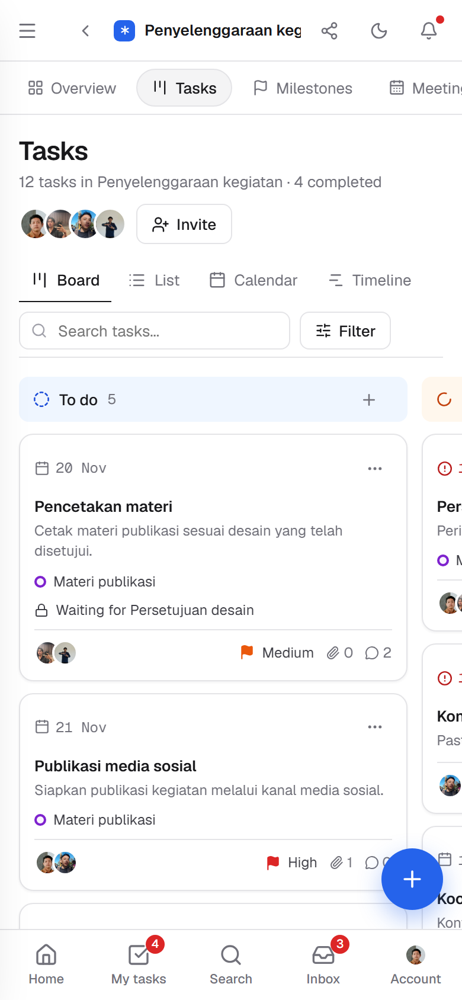                     |
| Kartu ringkasan menjadi grid dua kolom, tab proyek bisa digeser di atas, dan navigasi utama pindah ke bawah layar.                                       | Kolom Board digeser ke samping, tombol + mengambang untuk tugas baru, dan navigasi Home, My tasks, Search, Inbox, Account. |

## 5. Cara Openspace dibangun

Bagian ini menjelaskan proses dan keputusan di balik Openspace, dari rancangan di Figma sampai rilis. Setiap klaim menunjuk ke kode, konfigurasi, atau riwayat repository yang bisa diperiksa. Rincian pengembangan lanjutan dan 21 skenario pengujian black-box ada di [dokumen pengembangan lanjutan](docs/Penerapan-Materi-RPL.md).

### 5.1 Dari wireframe ke prototipe

Antarmuka dirancang di Figma sebelum kode ditulis, dalam dua tahap: wireframe untuk menguji struktur dan alur, lalu prototipe untuk menetapkan tampilan akhir. File Figma-nya memisahkan kedua tahap ke halaman **WIREFRAME** dan **PROTOTYPE**.

<!-- figma-editor -->

**Tahap 1: wireframe.** Wireframe dibuat hitam-putih tanpa warna, supaya diskusi fokus pada isi halaman dan urutan langkah, bukan gaya. Ada 12 frame dalam tiga kelompok:

| Kelompok         | Frame                                                                             |
| ---------------- | --------------------------------------------------------------------------------- |
| Tugas            | Dashboard proyek, Kanban, Detail tugas, Proyek kosong, Memuat tugas, Gagal memuat |
| Rapat            | Rapat, Form tugas dari action item, Rapat tanpa izin                              |
| Anggota dan role | Anggota, Editor role, Role masih dipakai                                          |

Keadaan khusus (data kosong, memuat, gagal, tanpa izin, dan tindakan yang ditolak) sudah dirancang sejak wireframe, bukan ditambahkan belakangan. Contohnya, frame _Rapat tanpa izin_ menetapkan bahwa Member tetap bisa membaca rapat tetapi tidak bisa mengubahnya, dan frame _Role masih dipakai_ menetapkan pesan penolakan beserta jalan keluarnya.

**Tahap 2: prototipe.** Halaman PROTOTYPE berisi sistem desain (token warna, skala tipografi Geist, dan komponen), layar desktop, dialog dan keadaan khusus, layar autentikasi, serta layar ponsel. Perubahan utama dari wireframe:

| Di wireframe                                                    | Di prototipe                                                                               |
| --------------------------------------------------------------- | ------------------------------------------------------------------------------------------ |
| Tampilan tugas hanya Kanban dan Daftar                          | Empat tampilan: Board, List, Calendar, dan Timeline                                        |
| Menu proyek terpisah dengan tombol "Kembali ke proyek"          | Satu sidebar berisi workspace, pencarian, dan daftar proyek beserta submenunya             |
| Status dan prioritas ditulis sebagai teks biasa                 | Label status dan prioritas dengan ikon dan teks berkontras tinggi                          |
| Prasyarat hanya tertulis sebagai teks di kartu dan detail tugas | Timeline menampilkan status, penanggung jawab, dan garis ketergantungan di dalam bar       |
| Izin role berupa daftar centang                                 | Halaman Roles dengan pola daftar dan detail, ditambah dialog Compare roles yang hanya-baca |
| Belum ada gaya visual                                           | Sistem desain yang dipakai ulang di semua layar, termasuk tata letak ponsel                |

Halaman Roles sengaja tidak memakai tabel izin dengan semua role sebagai kolom. Tabel seperti itu sulit dibaca dan rawan salah ubah ketika jumlah role bertambah.

**Tahap 3: implementasi.** Kode mengikuti prototipe secara langsung. Komentar di komponen menyebut frame acuannya, misalnya navigasi bawah ponsel di [`AppLayout.jsx`](frontend/src/components/layout/AppLayout.jsx) dan menu tekan lama di [`ContextMenu.jsx`](frontend/src/components/ui/ContextMenu.jsx). Data contoh di [`seed.js`](backend/prisma/seed.js) juga memakai isi prototipe: proyek "Penyelenggaraan kegiatan", tugas, rapat, dan anggotanya.

| Wireframe                                                                                                                                                                                               | Aplikasi jadi                                                                                                                                                  |
| ------------------------------------------------------------------------------------------------------------------------------------------------------------------------------------------------------- | -------------------------------------------------------------------------------------------------------------------------------------------------------------- |
| 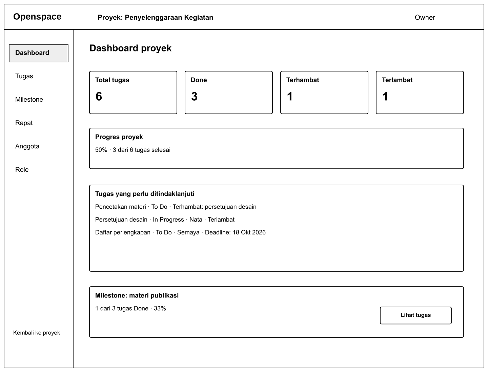                              |  |
| Dashboard: empat kartu angka, progres, tugas yang perlu ditindaklanjuti, dan satu milestone.                                                                                                            | Overview: kartu angka yang sama, ditambah beban kerja per anggota dan rincian milestone.                                                                       |
| 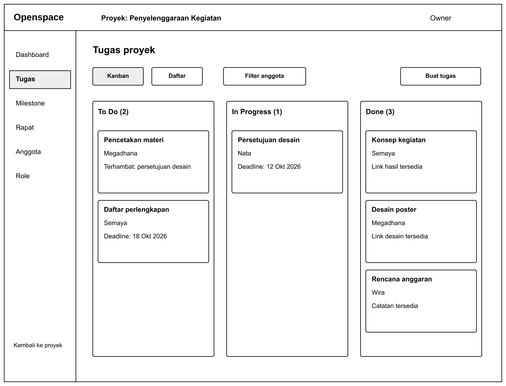                                                                                     |                                                               |
| Kanban dengan tombol Kanban, Daftar, dan Filter anggota.                                                                                                                                                | Board dengan empat tab tampilan, pencarian, filter, dan tambah cepat.                                                                                          |
| 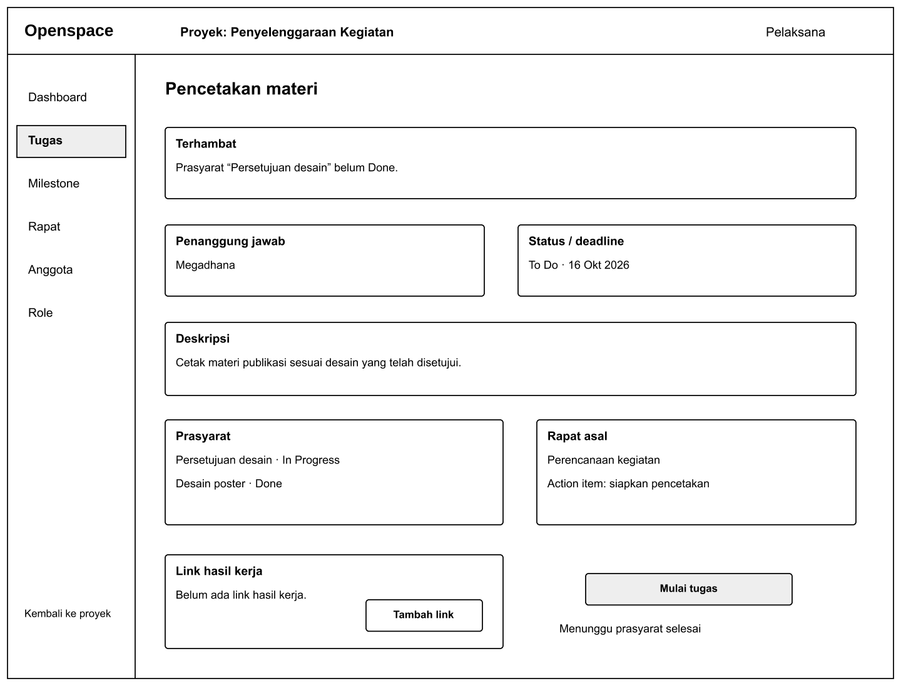 |                                                                 |
| Detail tugas sebagai halaman penuh, dengan penanda terhambat dan rapat asal.                                                                                                                            | Detail tugas sebagai panel di kanan, jadi konteks halaman tetap terlihat.                                                                                      |
| 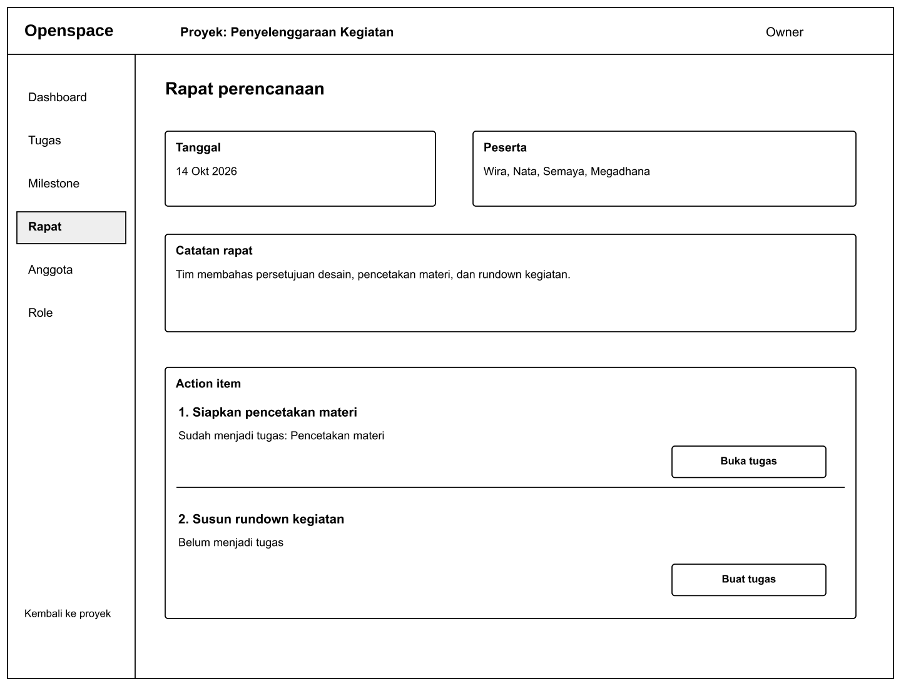                             |                                             |
| Satu rapat dengan action item yang sudah atau belum menjadi tugas.                                                                                                                                      | Daftar rapat di kiri dan detail di kanan; action item menampilkan status tugasnya.                                                                             |

### 5.2 Pengembangan bertahap

Setelah prototipe disepakati, sistem dikirim dalam beberapa inkremen. Fitur dengan prioritas tertinggi dikerjakan lebih dulu, dan setiap inkremen menghasilkan aplikasi yang tetap bisa dijalankan.

| Inkremen           | Pull Request   | Isi                                                                                                                                     |
| ------------------ | -------------- | --------------------------------------------------------------------------------------------------------------------------------------- |
| 1. Fondasi backend | #1 sampai #6   | Setup Express, skema Prisma dan migrasi, autentikasi JWT, pemeriksaan izin, endpoint proyek, anggota, role, tugas, milestone, dan rapat |
| 2. Antarmuka       | #7 sampai #16  | Setup Vite, komponen UI, layout dan routing, halaman auth, empat tampilan tugas, Overview, Milestones, Meetings, Members, Roles         |
| 3. Siap production | #17 sampai #22 | Pengamanan akun (pembatasan login, password untuk ganti email), deploy backend dan frontend di Vercel, rilis ke `main`                  |
| 4. Penyempurnaan   | #23 sampai #27 | Dark mode, menu klik kanan, Timeline interaktif, tampilan ponsel, transisi, 43 uji unit, README                                         |

Setiap inkremen melewati Pull Request ke `develop`, lalu dirilis ke `main`. Riwayatnya bisa ditelusuri di tab [Pull requests](https://github.com/agvswira/openspace/pulls?q=is%3Apr+is%3Amerged).

Kebutuhan disusun dalam empat langkah:

1. **Menilai kelayakan:** cakupan dipilih sesuai kemampuan tim dan layanan gratis yang tersedia. Rapat dicatat manual, hasil kerja disimpan sebagai link (bukan unggahan berkas), dan tidak ada chat langsung antaranggota.
2. **Menggali kebutuhan:** studi pustaka, analisis aplikasi sejenis, dan diskusi kelompok.
3. **Menuliskan kebutuhan:** kebutuhan fungsional FR-01 sampai FR-19, kebutuhan non-fungsional, dan aturan fitur.
4. **Memvalidasi:** wireframe dan prototipe ditinjau sebelum fitur dibuat. Masukan dosen ditampung sebagai inkremen baru lewat branch fitur, bukan dengan mengubah rilis yang sudah berjalan.

### 5.3 Kebutuhan dan aturan sistem

Openspace baru berguna ketika aplikasi, orang (Owner, Koordinator, Member), dan cara kerja tim (rapat, pembagian tugas, tenggat) berjalan bersama. Contohnya, prasyarat tugas hanya membantu kalau tim memang mencatat urutan kerjanya. Karena itu kebutuhannya dibagi tiga:

| Jenis                        | Contoh                                                                                                                                                                                |
| ---------------------------- | ------------------------------------------------------------------------------------------------------------------------------------------------------------------------------------- |
| Fungsi                       | Mengelola proyek, anggota, tugas, prasyarat, rapat, milestone, dan notifikasi                                                                                                         |
| Sifat sistem                 | Password di-hash, token sekali pakai, status tidak dibedakan hanya dengan warna, empat tampilan membaca data yang sama                                                                |
| Hal yang tidak boleh terjadi | Pengguna melihat proyek yang bukan miliknya. Member mengubah tugas orang lain. Prasyarat membentuk siklus. Satu action item menghasilkan dua tugas. Role yang masih dipakai terhapus. |

Sifat seperti keamanan tidak dimiliki satu komponen saja. Keamanan Openspace muncul dari gabungan middleware akses, constraint unik di database (misalnya satu anggota hanya punya satu role per proyek), validasi input, dan antarmuka yang menonaktifkan aksi terlarang. Karena itu sifat ini diuji setelah semua bagian terhubung: pengujian API dengan empat role dijalankan terhadap aplikasi yang berjalan, bukan per fungsi.

### 5.4 Arsitektur dan keputusan desain

Kebutuhan dikelompokkan (akun, proyek dan anggota, role dan izin, tugas, kolaborasi, rapat, notifikasi), lalu dibagi ke empat sub-sistem dengan antarmuka yang jelas:

| Sub-sistem      | Tanggung jawab                               | Antarmuka                                 |
| --------------- | -------------------------------------------- | ----------------------------------------- |
| Frontend React  | Penyajian dan interaksi                      | REST API dengan JSON ke backend           |
| Backend Express | Autentikasi, pemeriksaan izin, aturan bisnis | Prisma ke database, SMTP ke layanan email |
| PostgreSQL      | Data dan integritas relasi                   | Diakses lewat Prisma                      |
| Layanan email   | Undangan dan reset password                  | SMTP                                      |

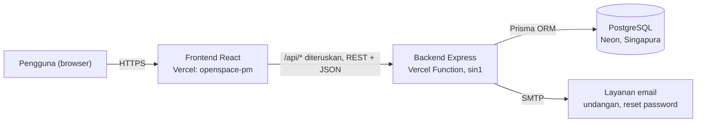

| Lapisan desain | Keputusan                                                                                                                                                                                  |
| -------------- | ------------------------------------------------------------------------------------------------------------------------------------------------------------------------------------------ |
| Arsitektur     | Frontend, backend, database, dan email dipisah seperti diagram di atas                                                                                                                     |
| Aturan bisnis  | Tugas terhambat tidak bisa dimulai, tugas Done tidak dibuka kembali bila tugas lanjutannya sudah berjalan, dan aturan lain ditulis sebagai fungsi murni                                    |
| Antarmuka API  | Kontrak REST di [`backend/src/routes`](backend/src/routes)                                                                                                                                 |
| Komponen       | Komponen React yang dipakai ulang di [`frontend/src/components/ui`](frontend/src/components/ui), misalnya `Modal`, `Menu`, dan [`ContextMenu`](frontend/src/components/ui/ContextMenu.jsx) |
| Struktur data  | 19 model di [`schema.prisma`](backend/prisma/schema.prisma)                                                                                                                                |
| Algoritma      | Deteksi siklus prasyarat dengan DFS ([`findCyclePath`](backend/src/lib/taskRules.js)); progres dihitung dari jumlah tugas Done dibagi seluruh tugas                                        |

Skema database berubah lewat migrasi bertahap di [`backend/prisma/migrations`](backend/prisma/migrations) (init, lalu avatar pengguna, lalu ikon proyek). Lingkungan deploy juga pernah berubah dari rencana Render ke Vercel tanpa mengubah perilaku aplikasi (risiko T1 di [5.8](#58-manajemen-proyek-dan-risiko)). Proyek yang tidak dipakai lagi bisa diarsipkan menjadi hanya-baca sebelum dihapus, dan penghapusan membersihkan data turunannya dengan urutan yang menjaga relasi.

### 5.5 Kualitas yang dijaga

| Kualitas                | Penerapan                                                                                                                                                                                                                                                                                                                                                                                                                       |
| ----------------------- | ------------------------------------------------------------------------------------------------------------------------------------------------------------------------------------------------------------------------------------------------------------------------------------------------------------------------------------------------------------------------------------------------------------------------------- |
| Mudah dipelihara        | Monorepo dengan batas yang jelas: [`backend/`](backend) dan [`frontend/`](frontend). Aturan bisnis ditulis sebagai fungsi murni di [`taskRules.js`](backend/src/lib/taskRules.js) dan [`taskGuards.js`](frontend/src/lib/taskGuards.js), sehingga bisa diuji tanpa browser atau database. ESLint dan Prettier menjaga gaya kode, dan [`CONTRIBUTING.md`](CONTRIBUTING.md) mengatur branch, format commit, dan kepemilikan file. |
| Andal dan aman          | Password disimpan sebagai hash bcrypt. Token reset password dan undangan hanya disimpan hash SHA-256-nya, sekali pakai, dan punya masa berlaku ([`tokens.js`](backend/src/lib/tokens.js)). Semua input divalidasi Zod, dan perubahan yang saling terkait dibungkus transaksi Prisma.                                                                                                                                            |
| Efisien                 | Empat tampilan tugas berbagi satu cache React Query, jadi data tugas tidak diambil ulang per tampilan. Backend berjalan di region Singapura (`sin1`), sedekat mungkin dengan database Neon.                                                                                                                                                                                                                                     |
| Mudah diterima pengguna | Status selalu tampil sebagai ikon dan teks, bukan warna saja. Setiap penolakan menyebut alasannya, misalnya "Tugas ini masih menunggu: Persetujuan desain". Tersedia navigasi keyboard, tema gelap, dan tata letak ponsel.                                                                                                                                                                                                      |

Tiga hal lain ikut menentukan cara kerja tim:

- **Banyak lingkungan:** aplikasi yang sama berjalan di desktop, tablet, ponsel, tema terang dan gelap, serta di laptop (PostgreSQL bawaan lewat `embedded-postgres`) maupun di cloud (Vercel serverless dengan Neon).
- **Pengiriman cepat:** setiap fitur dikirim lewat branch kecil dan Pull Request. Merge ke `main` langsung memicu deploy production di Vercel.
- **Bisa dipercaya:** izin selalu diperiksa di backend; antarmuka hanya menonaktifkan tombol. Mematikan JavaScript atau memanggil API langsung tidak memberi akses tambahan.

### 5.6 Pengujian

| Tingkat             | Penerapan                                                                                                                                                                     | Status                                                                             |
| ------------------- | ----------------------------------------------------------------------------------------------------------------------------------------------------------------------------- | ---------------------------------------------------------------------------------- |
| Unit                | 43 uji unit dengan `node:test`: aturan tugas, katalog izin, serializer (termasuk memastikan `passwordHash` tidak bocor), dan logika seret Timeline. Jalankan `npm test`.      | 43 lulus                                                                           |
| Sistem              | Uji API terhadap aplikasi yang berjalan dengan empat role, 21 skenario black-box di browser, dan simulasi production (database kosong, `NODE_ENV=production`) sebelum deploy. | Lulus, rinciannya di [dokumen pengembangan lanjutan](docs/Penerapan-Materi-RPL.md) |
| Penerimaan pengguna | User Acceptance Testing bersama calon pengguna.                                                                                                                               | Direncanakan                                                                       |

Sebelum setiap Pull Request, `npm run lint`, `npm run format:check`, `npm test`, dan `npm run build` dijalankan.

### 5.7 Alur kerja tim dan alat

| Praktik              | Penerapan                                                                                                                |
| -------------------- | ------------------------------------------------------------------------------------------------------------------------ |
| Iteratif             | Empat inkremen di [5.2](#52-pengembangan-bertahap)                                                                       |
| Kebutuhan tercatat   | Kebutuhan diberi kode (FR-01 dan seterusnya) dan dirujuk dari pengujian                                                  |
| Berbasis komponen    | Komponen UI yang dipakai ulang di frontend; route, middleware, dan lib yang terpisah di backend                          |
| Dimodelkan visual    | Wireframe dan prototipe di Figma; use case, class, sequence, activity diagram, dan ERD                                   |
| Kualitas diperiksa   | Uji unit, uji sistem, lint, dan build sebelum merge                                                                      |
| Perubahan terkendali | Branch per fitur, Pull Request ke `develop`, rilis ke `main`, merge commit (bukan squash) agar riwayat tiap anggota utuh |

| Kegunaan                        | Alat                                                           |
| ------------------------------- | -------------------------------------------------------------- |
| Perencanaan                     | Openspace sendiri dan GitHub Pull Requests                     |
| Desain dan prototipe            | Figma                                                          |
| Penulisan kode                  | Visual Studio Code                                             |
| Manajemen versi dan konfigurasi | Git, GitHub, Prisma Migrate                                    |
| Skema dan data                  | Prisma, Prisma Studio                                          |
| Build                           | Node.js, Vite                                                  |
| Analisis kode                   | ESLint, Prettier                                               |
| Pengujian                       | `node:test`                                                    |
| Dokumentasi                     | Markdown (README, CONTRIBUTING, dokumen pengembangan lanjutan) |

### 5.8 Manajemen proyek dan risiko

Manajemen proyek muncul dua kali: sebagai **fitur** Openspace dan sebagai **cara tim mengelola** proyek Openspace sendiri.

| Kebutuhan pengelola proyek          | Fitur Openspace                                                                |
| ----------------------------------- | ------------------------------------------------------------------------------ |
| Titik pencapaian yang bisa dinilai  | Halaman Milestones dengan deadline, penanggung jawab, dan progres              |
| Jadwal visual                       | Timeline: setiap tugas digambar sebagai bar dari tanggal mulai sampai deadline |
| Urutan dan ketergantungan pekerjaan | Prasyarat tugas dengan garis putus-putus di Timeline dan penanda "terhambat"   |
| Pembagian beban kerja               | Kartu _Workload by assignee_ di Overview                                       |
| Pemantauan progres                  | Overview: progres, tugas terlambat, terhambat, dan perlu perhatian             |
| Rapat kemajuan                      | Halaman Meetings dengan action item yang menjadi tugas                         |
| Penempatan orang                    | Owner memilih anggota dan menetapkan role sesuai tanggung jawab                |

**Rencana proyek tim:**

| Bagian rencana           | Isi untuk Openspace                                                                                  |
| ------------------------ | ---------------------------------------------------------------------------------------------------- |
| Pendahuluan              | Latar belakang, rumusan masalah, dan tujuan                                                          |
| Organisasi proyek        | Empat anggota dengan area kode masing-masing ([bagian 9](#9-tim))                                    |
| Analisis risiko          | Tabel risiko di bawah                                                                                |
| Sumber daya              | Layanan gratis: Vercel Hobby, Neon Free, Gmail SMTP                                                  |
| Pembagian kerja          | Area kode per anggota di [`CONTRIBUTING.md`](CONTRIBUTING.md), dipecah lagi menjadi branch per fitur |
| Jadwal                   | Urutan merge: backend, fondasi frontend, halaman, deploy, penyempurnaan                              |
| Pemantauan dan pelaporan | Review Pull Request, status deploy di Vercel, dan rapat kelompok                                     |

**Risiko** dikelompokkan menurut sumbernya (teknologi, orang, organisasi, kebutuhan, estimasi), dinilai peluang dan dampaknya, lalu diberi strategi: dihindari, dikurangi dampaknya, atau disiapkan rencana cadangan. Sebagian risiko di bawah benar-benar terjadi selama pengerjaan.

| ID  | Risiko                                                                | Sumber     | Peluang | Dampak           | Strategi                                                                              | Hasil                                                                     |
| --- | --------------------------------------------------------------------- | ---------- | ------- | ---------------- | ------------------------------------------------------------------------------------- | ------------------------------------------------------------------------- |
| T1  | Layanan hosting backend gratis ternyata meminta kartu pembayaran      | Teknologi  | Tinggi  | Serius           | Rencana cadangan: pindah ke Vercel Functions                                          | Terjadi. Kartu ditolak Render, backend dipindah ke Vercel (#19)           |
| T2  | Layanan email tidak bisa mengirim ke alamat lain tanpa domain sendiri | Teknologi  | Tinggi  | Serius           | Rencana cadangan: Gmail SMTP dengan App Password                                      | Terjadi pada Resend, diganti Gmail SMTP                                   |
| T3  | Database gratis tidur saat tidak dipakai, request pertama lambat      | Teknologi  | Tinggi  | Bisa ditoleransi | Dikurangi: backend dan database di region yang sama, buka aplikasi sebelum demo       | Diterima                                                                  |
| T4  | Seed tidak sengaja dijalankan di production dan menghapus semua akun  | Organisasi | Rendah  | Fatal            | Dihindari: seed menolak `NODE_ENV=production` (#17)                                   | Dicegah                                                                   |
| T5  | Akun dibobol dengan menebak password                                  | Teknologi  | Sedang  | Serius           | Dikurangi: batas 10 percobaan gagal per email per 15 menit (#17)                      | Dicegah                                                                   |
| P1  | Anggota berhalangan saat bagiannya dibutuhkan                         | Orang      | Sedang  | Serius           | Rencana cadangan: kepemilikan file tercatat dan perubahan lintas area lewat review PR | Perubahan lintas area ditandai untuk direview pemiliknya, misalnya di #24 |
| R1  | Kebutuhan berubah setelah masukan dosen                               | Kebutuhan  | Tinggi  | Bisa ditoleransi | Dikurangi: pengembangan inkremental, branch per fitur, preview deployment             | Berlangsung lewat inkremen berikutnya                                     |
| E1  | Cakupan terlalu besar untuk satu semester                             | Estimasi   | Sedang  | Serius           | Dihindari: fitur prioritas dikerjakan lebih dulu, cakupan dibatasi sejak awal         | Fitur inti selesai                                                        |

Hal yang tidak terduga hampir selalu muncul (T1 dan T2), jadi rencana deploy perlu cadangan waktu.

### 5.9 Tanggung jawab terhadap data dan pengguna

| Prinsip                            | Penerapan                                                                                                                                                                                                              |
| ---------------------------------- | ---------------------------------------------------------------------------------------------------------------------------------------------------------------------------------------------------------------------- |
| Kerahasiaan                        | Data proyek hanya bisa dibaca anggotanya. Secret tidak pernah masuk repository: hanya [`backend/.env.example`](backend/.env.example) tanpa nilai asli, dan nilai production disimpan di pengaturan environment Vercel. |
| Kejujuran tentang kemampuan sistem | Keterbatasan sistem ditulis terbuka di [bagian 11](#11-keterbatasan). Angka di README, seperti jumlah uji unit dan aturan izin, dicocokkan dengan kode.                                                                |
| Hak kekayaan intelektual           | Library, font, dan layanan dicantumkan beserta lisensinya di [bagian 10](#10-referensi-dan-kredit).                                                                                                                    |
| Mencegah penyalahgunaan            | Percobaan login dibatasi per email ([`rateLimit.js`](backend/src/lib/rateLimit.js)), dan seed yang menghapus seluruh data menolak berjalan di production ([`seed.js`](backend/prisma/seed.js)).                        |

## 6. Arsitektur dan struktur repository

```text
Per request
  Browser        halaman React; data diambil lewat React Query
  /api/*         diteruskan Vercel dari domain frontend ke backend (frontend/vercel.json)
  Express        requireAuth (JWT) → projectAccess (keanggotaan) → requirePermission (izin role)
                 → validate (Zod) → handler
  Prisma         query dan transaksi ke PostgreSQL
  Nodemailer     undangan dan reset password lewat SMTP
```

```text
openspace/
├── backend/
│   ├── prisma/           schema.prisma, migrasi, data contoh (seed.js)
│   ├── scripts/          dev.js (PostgreSQL bawaan), studio.js, sync-permissions.js
│   ├── src/
│   │   ├── routes/       auth, me, projects, members, roles, tasks, planning
│   │   ├── middleware/   auth (JWT), access (RBAC), validate (Zod), error
│   │   └── lib/          aturan tugas, izin, token, email, notifikasi, rate limit
│   ├── test/             uji unit backend
│   └── vercel.json       region sin1 dan perintah build
├── frontend/
│   ├── src/
│   │   ├── pages/        Home, My tasks, Overview, Tasks, Milestones, Meetings, Members, Roles, Settings
│   │   ├── components/   layout, tasks (Board, List, Calendar, Timeline), ui
│   │   ├── context/      autentikasi, tema, toast
│   │   ├── api/          axios client dan hook React Query
│   │   └── lib/          format, status, aturan seret Timeline
│   ├── test/             uji unit frontend
│   └── vercel.json       rewrite /api ke backend
├── docs/                 dokumen pengembangan lanjutan, PDF penjelasan, gambar README
└── Jalankan-Openspace.bat
```

| Lapisan  | Teknologi                                                                                                     |
| -------- | ------------------------------------------------------------------------------------------------------------- |
| Frontend | React 19, Vite 7, React Router 7, TanStack React Query 5, Axios, Lucide icons                                 |
| Backend  | Node.js, Express 5, JSON Web Token, bcryptjs, Zod, Nodemailer                                                 |
| Database | PostgreSQL lewat Prisma ORM 6. Saat pengembangan, PostgreSQL 18 dijalankan otomatis lewat `embedded-postgres` |
| Hosting  | Vercel (frontend dan backend, region Singapura), Neon Postgres (Singapura)                                    |

## 7. Menjalankan di komputer sendiri

Butuh **Node.js 20 atau lebih baru**. PostgreSQL tidak perlu diinstal.

**Cara cepat (Windows):** klik dua kali `Jalankan-Openspace.bat`. Saat pertama kali dijalankan, file ini menginstal dependensi (butuh internet, beberapa menit). Setelah itu browser terbuka di http://localhost:5180. Tutup jendela hitamnya untuk menghentikan aplikasi.

**Windows, macOS, atau Linux:**

```bash
npm run setup
```

```bash
npm run dev
```

Lalu buka **http://localhost:5180**. `npm run dev` menjalankan dua proses:

- `api` (port 4000): menyalakan PostgreSQL bawaan di port 5433, menerapkan migrasi, mengisi data contoh bila database masih kosong, lalu menjalankan REST API.
- `web` (port 5180): Vite dev server. Permintaan `/api` diteruskan ke port 4000.

**Akun demo lokal.** Semua memakai password `password123`. Akun ini hanya ada di database lokal, tidak di aplikasi live.

| Email                       | Role di proyek "Penyelenggaraan kegiatan" |
| --------------------------- | ----------------------------------------- |
| wira@openspace.example      | Owner                                     |
| nata@openspace.example      | Koordinator (custom role)                 |
| semaya@openspace.example    | Member                                    |
| megadhana@openspace.example | Pelaksana (custom role)                   |

Login dengan akun berbeda untuk mencoba pembatasan akses, misalnya Member tidak bisa membuat tugas.

| Perintah               | Fungsi                                                              |
| ---------------------- | ------------------------------------------------------------------- |
| `npm run db:reset`     | Menghapus database lokal dan mengisi ulang data contoh              |
| `npm run db:studio`    | Membuka Prisma Studio untuk melihat isi tabel                       |
| `npm test`             | Menjalankan 43 uji unit backend dan frontend                        |
| `npm run lint`         | Memeriksa kode dengan ESLint                                        |
| `npm run format:check` | Memeriksa format dengan Prettier (`npm run format` untuk merapikan) |
| `npm run build`        | Build frontend untuk produksi (`frontend/dist`)                     |

Tanpa `SMTP_HOST`, email undangan dan reset password dicetak di terminal `api`, sehingga tautannya bisa langsung disalin ke browser.

## 8. Variabel environment dan deployment

Nama variabel ada di [`backend/.env.example`](backend/.env.example). Saat `npm run dev` pertama kali dijalankan, `backend/.env` dibuat otomatis dengan `JWT_SECRET` acak. File `.env` diabaikan git, dan nilai production hanya disimpan di pengaturan Vercel.

| Variabel                                                        | Fungsi                                                                     |
| --------------------------------------------------------------- | -------------------------------------------------------------------------- |
| `API_PORT`                                                      | Port REST API lokal. Di Vercel tidak diisi                                 |
| `CLIENT_URL`                                                    | Alamat frontend, untuk CORS dan tautan di email                            |
| `USE_EMBEDDED_DB`, `EMBEDDED_DB_PORT`                           | `true` menjalankan PostgreSQL bawaan; `false` memakai `DATABASE_URL`       |
| `DATABASE_URL`                                                  | Koneksi PostgreSQL                                                         |
| `JWT_SECRET`, `JWT_EXPIRES_IN`                                  | Kunci dan masa berlaku token login. `JWT_SECRET` wajib diisi di production |
| `SMTP_HOST`, `SMTP_PORT`, `SMTP_USER`, `SMTP_PASS`, `MAIL_FROM` | Pengiriman email. Gunakan port 587                                         |

**Deployment.** Repository dihubungkan ke dua project Vercel dengan production branch `main`:

| Project  | Root directory | Isi                                                                                                                                                                                                 |
| -------- | -------------- | --------------------------------------------------------------------------------------------------------------------------------------------------------------------------------------------------- |
| Frontend | `frontend`     | Build Vite. [`frontend/vercel.json`](frontend/vercel.json) meneruskan `/api/*` ke backend dan mengarahkan path lain ke `index.html`                                                                 |
| Backend  | `backend`      | Express sebagai satu Vercel Function. [`backend/vercel.json`](backend/vercel.json) memilih region `sin1` dan menjalankan `prisma generate`, `prisma migrate deploy`, lalu sinkronisasi katalog izin |

Database production dimulai kosong; seed tidak pernah dijalankan di sana. Akun pertama dibuat lewat halaman Register.

## 9. Tim

| Nama                                   | GitHub                                                | Area utama di repository                                                                                  |
| -------------------------------------- | ----------------------------------------------------- | --------------------------------------------------------------------------------------------------------- |
| Komang Agus Wira Adnyana (koordinator) | [agvswira](https://github.com/agvswira)               | Backend (Express, Prisma, autentikasi, RBAC, aturan tugas), pengamanan akun, deployment                   |
| Ida Bagus Pradnya Subhiksa Semaya      | [gussubhiksa-png](https://github.com/gussubhiksa-png) | Fondasi frontend: setup Vite, API client, komponen UI, layout dan routing, halaman auth, Home, Settings   |
| I Gede Bagus Nata Krisnu               | [gnk969](https://github.com/gnk969)                   | Overview, Milestones, Meetings, Members, Roles; dark mode, Timeline interaktif, tampilan ponsel, uji unit |
| I Made Megadhana                       | [mademegadhana](https://github.com/mademegadhana)     | Komponen tugas: Board, List, Calendar, Timeline, panel detail, form tugas, My tasks                       |

Alur kerja tim, format commit, dan pembagian file ada di [`CONTRIBUTING.md`](CONTRIBUTING.md).

## 10. Referensi dan kredit

- **Library:** React, React Router, TanStack Query, Axios, Vite, Express, Zod, jsonwebtoken, cors, dan embedded-postgres (MIT); Prisma (Apache-2.0); bcryptjs (BSD-3-Clause); dotenv (BSD-2-Clause); Nodemailer (MIT-0); Lucide icons (ISC).
- **Font:** Geist dan Geist Mono dari Google Fonts (SIL Open Font License).
- **Infrastruktur:** Vercel, Neon Postgres.
- **Data contoh:** proyek "Penyelenggaraan kegiatan" dan tokohnya dibuat tim untuk demo.

## 11. Keterbatasan

- **Pembatasan login disimpan di memori server.** Di Vercel, setiap instance punya hitungannya sendiri, jadi batasnya tidak seketat di satu server. Orang lain juga bisa sengaja mengunci login sebuah email selama 15 menit.
- **Email akun belum diverifikasi.** Karena itu token undangan hanya dikirim ke kotak masuk email, tidak ke notifikasi di aplikasi.
- **Sesi lama tetap berlaku sampai 7 hari** setelah password direset.
- **Layanan gratis:** Gmail SMTP dibatasi sekitar 500 email per hari dan kadang masuk folder Spam; database Neon tidur saat lama tidak dipakai.
- **Bundle JavaScript frontend** masih satu berkas di atas 500 kB; halaman belum dipecah dengan _lazy loading_.
- **User Acceptance Testing** belum dilaksanakan.
